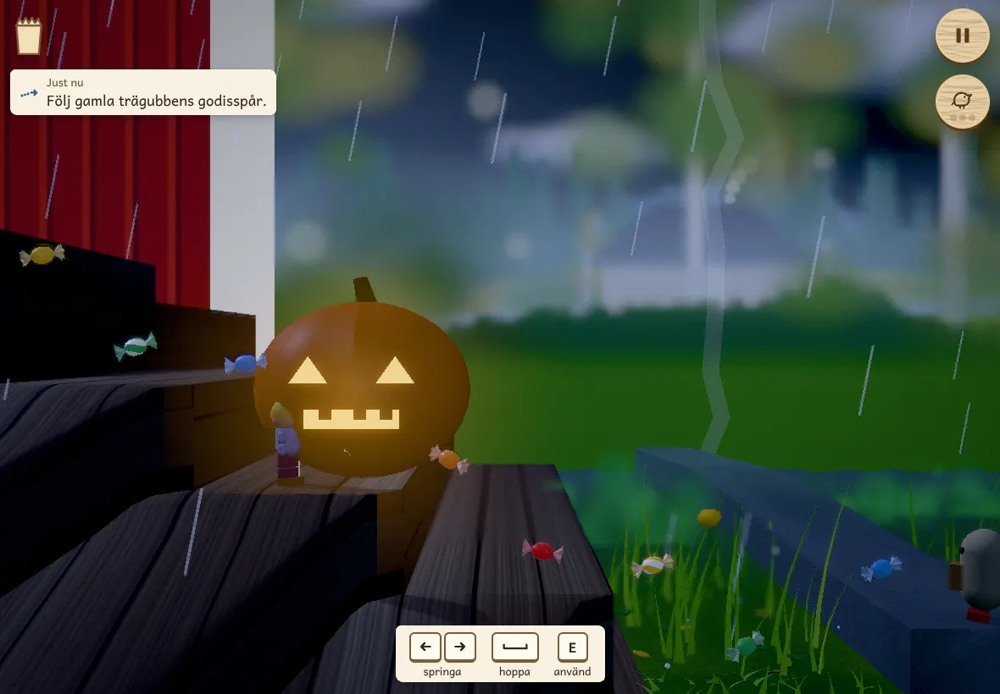

# Äventyr 2: Stormnatten — review captures

Checkpoint of the second adventure ([`docs/aventyr-2.md`](../../aventyr-2.md)), 4 November 2026. These are
captures of the production build, drawn in software (SwiftShader) on the High tier, with the public stand-in
figures for Elof, Klonk and the family (`?standin`). No reference photograph or private character asset is in
this gallery. The game's own reminder, buttons and bubbles are left in the picture.

The five main pictures show Stormgården at its first big candy: the pumpkin lantern on the steps, rain and a far
flash of lightning, and the old trägubbe's candy trail on the lawn.

| Viewport | Tier | Capture |
| --- | --- | --- |
| 390 × 844 | High | [Portrait phone](390x844.webp) |
| 844 × 390 | High | [Landscape phone](844x390.webp) |
| 780 × 360 | High | [Short landscape phone](780x360.webp) |
| 1180 × 820 | High | [Tablet](1180x820.webp) |
| 1440 × 900 | High | [Desktop](1440x900.webp) |

One picture from each of the other chapters, at 844 × 390:

| Chapter | Moment |
| --- | --- |
| [Stormkvällen](1-stormkvall-844x390.webp) | Small again on the deck, the storm-dark garden below |
| [Stormskogen](3-stormskog-844x390.webp) | Pappa's beam has frozen Klonk stiff as a plank across the gap |
| [Byn i stormen](4-stormbyn-844x390.webp) | On the wall, about to call Moa for her umbrella |
| [Sjön](5-sjon-844x390.webp) | Sheltering behind the jetty's posts from the waves |
| [Stormens öga](6-stormoga-844x390.webp) | The storm's eye: stars and moon, the two trägubbar on the stone |
| [Morgonen efter](7-morgonen-844x390.webp) | Sunday morning, both figures back on the shelf |
