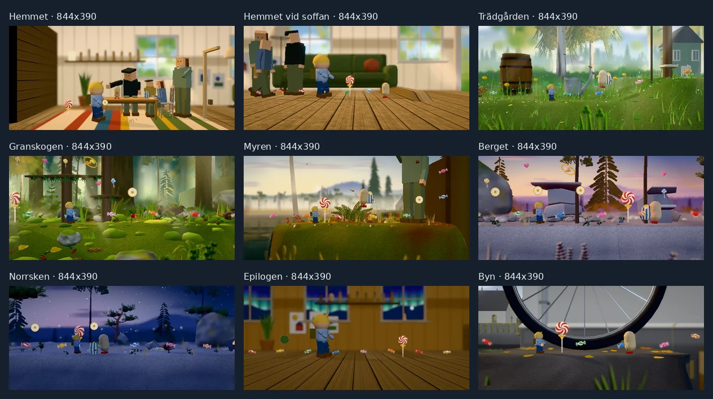
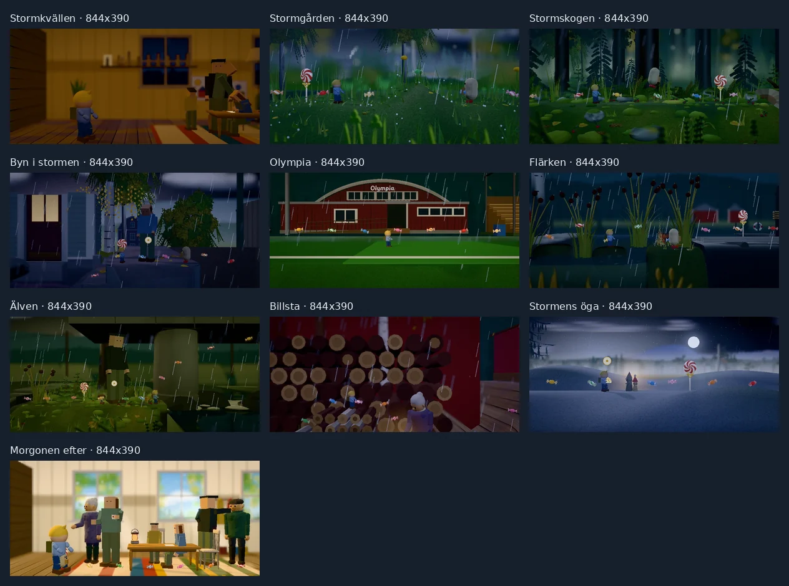
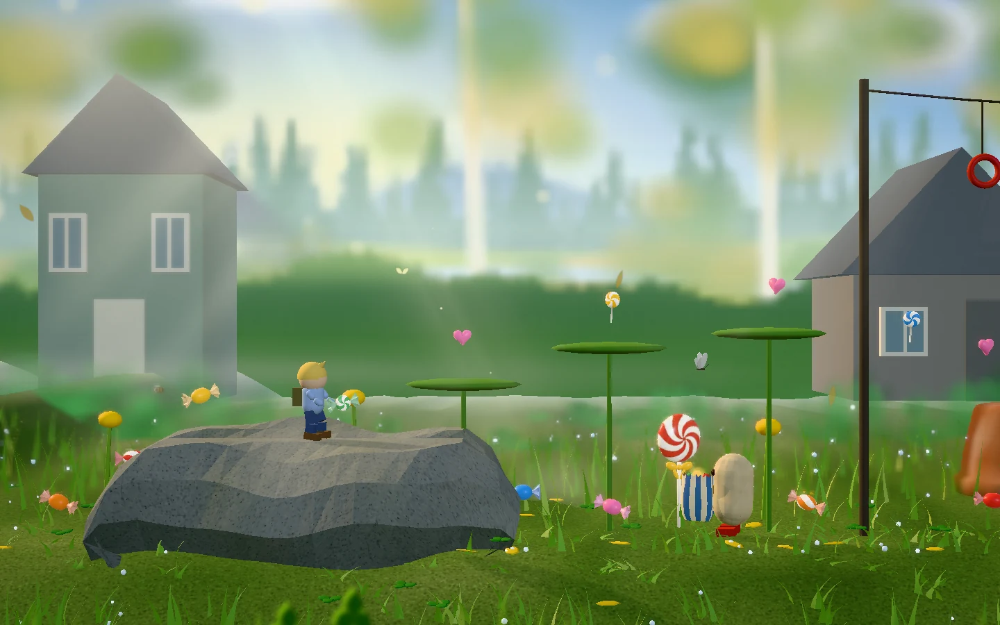

# Graphics overhaul — public review gallery

5 November 2026. These 56 captures review the shared home, scenery and lighting across both adventures.
The first adventure has nine views at five sizes: all eight chapters, plus the sofa area of the prologue.
The second adventure has one view of each of its ten chapters at 844 × 390.
One additional view at 1440 × 900 records the corrected garden boulder and its foot contact.

Every image uses the public stand-in characters and buildings. No reference photograph, likeness model or private
asset appears in this gallery. The source renderer runs on High in Chromium with SwiftShader, at device scale 1.
These isolated views omit title, HUD, dialogue and pause UI; they do not establish performance or private-model
contact on the family devices. See the [graphics audit](../../graphics-overhaul-audit.md) for the broader checks.

## Contact sheets

| Viewport | First adventure | Second adventure |
| --- | --- | --- |
| 390 × 844 | [Nine views](aventyr1-390x844-contact.webp) | — |
| 844 × 390 | [Nine views](aventyr1-844x390-contact.webp) | [Ten chapters](aventyr2-844x390-contact.webp) |
| 780 × 360 | [Nine views](aventyr1-780x360-contact.webp) | — |
| 1180 × 820 | [Nine views](aventyr1-1180x820-contact.webp) | — |
| 1440 × 900 | [Nine views](aventyr1-1440x900-contact.webp) | — |





## Full-size images

| First adventure | 390 × 844 | 844 × 390 | 780 × 360 | 1180 × 820 | 1440 × 900 |
| --- | --- | --- | --- | --- | --- |
| Hemmet | [View](home-390x844-high.webp) | [View](home-844x390-high.webp) | [View](home-780x360-high.webp) | [View](home-1180x820-high.webp) | [View](home-1440x900-high.webp) |
| Hemmet vid soffan | [View](home-sofa-390x844-high.webp) | [View](home-sofa-844x390-high.webp) | [View](home-sofa-780x360-high.webp) | [View](home-sofa-1180x820-high.webp) | [View](home-sofa-1440x900-high.webp) |
| Trädgården | [View](garden-390x844-high.webp) | [View](garden-844x390-high.webp) | [View](garden-780x360-high.webp) | [View](garden-1180x820-high.webp) | [View](garden-1440x900-high.webp) |
| Granskogen | [View](forest-390x844-high.webp) | [View](forest-844x390-high.webp) | [View](forest-780x360-high.webp) | [View](forest-1180x820-high.webp) | [View](forest-1440x900-high.webp) |
| Myren | [View](bog-390x844-high.webp) | [View](bog-844x390-high.webp) | [View](bog-780x360-high.webp) | [View](bog-1180x820-high.webp) | [View](bog-1440x900-high.webp) |
| Berget | [View](mountain-390x844-high.webp) | [View](mountain-844x390-high.webp) | [View](mountain-780x360-high.webp) | [View](mountain-1180x820-high.webp) | [View](mountain-1440x900-high.webp) |
| Norrsken | [View](finale-390x844-high.webp) | [View](finale-844x390-high.webp) | [View](finale-780x360-high.webp) | [View](finale-1180x820-high.webp) | [View](finale-1440x900-high.webp) |
| Epilogen | [View](epilogue-390x844-high.webp) | [View](epilogue-844x390-high.webp) | [View](epilogue-780x360-high.webp) | [View](epilogue-1180x820-high.webp) | [View](epilogue-1440x900-high.webp) |
| Byn | [View](village-390x844-high.webp) | [View](village-844x390-high.webp) | [View](village-780x360-high.webp) | [View](village-1180x820-high.webp) | [View](village-1440x900-high.webp) |

| Second adventure | 844 × 390 |
| --- | --- |
| Stormkvällen | [View](storm-evening-844x390-high.webp) |
| Stormgården | [View](storm-garden-844x390-high.webp) |
| Stormskogen | [View](storm-forest-844x390-high.webp) |
| Byn i stormen | [View](storm-village-844x390-high.webp) |
| Olympia | [View](olympia-844x390-high.webp) |
| Flärken | [View](flarken-844x390-high.webp) |
| Älven | [View](river-844x390-high.webp) |
| Billsta | [View](billsta-844x390-high.webp) |
| Stormens öga | [View](storm-eye-844x390-high.webp) |
| Morgonen efter | [View](next-morning-844x390-high.webp) |

## Garden stone detail

The walking strip remains level with the simulation. Its surrounding granite now forms one continuous faceted
surface with irregular shoulders, without a separate slab edge. This additional view preserves the reviewed fix.



## Validation and provenance

All 56 expected images were captured at their named dimensions. Each stays within the High draw-call gate of 300:
the recorded range is 45–104 draws and 19,987–245,237 triangles.
The capture reports contain zero page errors, console errors, missing responses and private-pack requests.
No installed model name begins with `private/`. Source fingerprints match before and after all four capture runs,
and all runs use the same source fingerprint and copied public asset manifest.

| Provenance | Value |
| --- | --- |
| Git base revision | `3b1687007a1aa495f1d5af2487184484e27818ea` |
| Source SHA-256 (216 files under `src/`) | `063a9b361473f28e8aef56ae53220cc31157a657cd98cdba28ad8edfb95ffaf1` |
| Public asset manifest SHA-256 | `7c818573ffcc35763a1cc8a87d7f4f0e0946fe7dd55f601aa182eb7fbaf448a3` |
| Main capture script SHA-256 | `821da76439b299a3306dfaad17aca10e2b1c2c32ccdf4ac4f0abe27d2262d6bf` |
| Corrected Billsta capture script SHA-256 | `e8474220195117d0c7fda2e1dfbd9b01ba1fd2e1dfb88f6d9f22988e60357a56` |
| Browser | Chromium `141.0.7390.37` |
| Settling per viewport | 6 render steps, 0.4 seconds each; shader warm-up complete |
| WebP encoding | RGB, quality 88, method 6; contact sheets quality 86 |

The Git revision identifies the base commit; the source fingerprint identifies the actual working-tree renderer
used for these captures. It hashes sorted source paths and bytes, separated by null bytes. The report records
the simulation position, flags, scene time, draw/triangle counts, installed public models and a SHA-256 for each
individual WebP; `captureContextIndex` links it to the corresponding context. The context records source changes,
requested sizes, browser version and capture settings.

Billsta was recaptured at `[43, 3.6]`, the log stack’s actual top, after the image review found that the fixture’s
original `[43, 0]` position hid Elof inside it. This one fixture correction explains the two capture-script hashes.
The earlier Billsta image is excluded from this gallery; renderer source and asset manifest hashes remain identical.

- [Capture report and image hashes](capture-report.json)
- [Capture contexts and matching source hashes](capture-context.json)
- [Capture runner](../../../tests/browser/visual-overhaul.mjs)

To repeat the source captures from the repository root:

```sh
VISUAL_FRAMES=6 VISUAL_CASES=home,home-sofa,garden,forest,bog,mountain,finale,epilogue,village VISUAL_SIZES=390x844,844x390,780x360,1180x820,1440x900 VISUAL_OUT=docs/shots/_work/visual-overhaul-e1 node tests/browser/visual-overhaul.mjs
VISUAL_FRAMES=6 VISUAL_CASES=storm-evening,storm-garden,storm-forest,storm-village,olympia,flarken,river,billsta,storm-eye,next-morning VISUAL_SIZES=844x390 VISUAL_OUT=docs/shots/_work/visual-overhaul-e2 node tests/browser/visual-overhaul.mjs
VISUAL_FRAMES=6 VISUAL_CASES=garden-boulder-middle VISUAL_SIZES=1440x900 VISUAL_OUT=docs/shots/_work/visual-overhaul-stone node tests/browser/visual-overhaul.mjs
```

Keep `src/` unchanged across all runs. The runner copies `public/` before each run so a concurrent asset build
cannot replace a model during a capture. It reuses each scene across its viewport sizes and advances six render
steps of 0.4 seconds per size; animation time therefore progresses through the five first-adventure images.
Camera easing uses elapsed time, and every recorded image has completed shader warm-up. These sparse render
steps are for static composition review; normal-frame-rate motion belongs to the animation and gameplay checks.
Raw PNGs remain in ignored working output. WebP conversion discards source image metadata.
